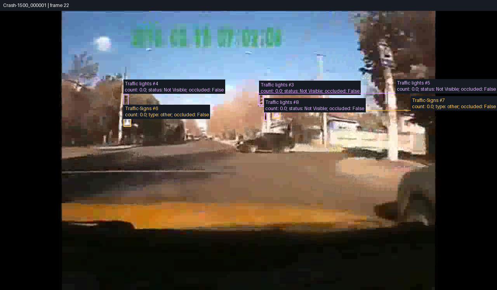
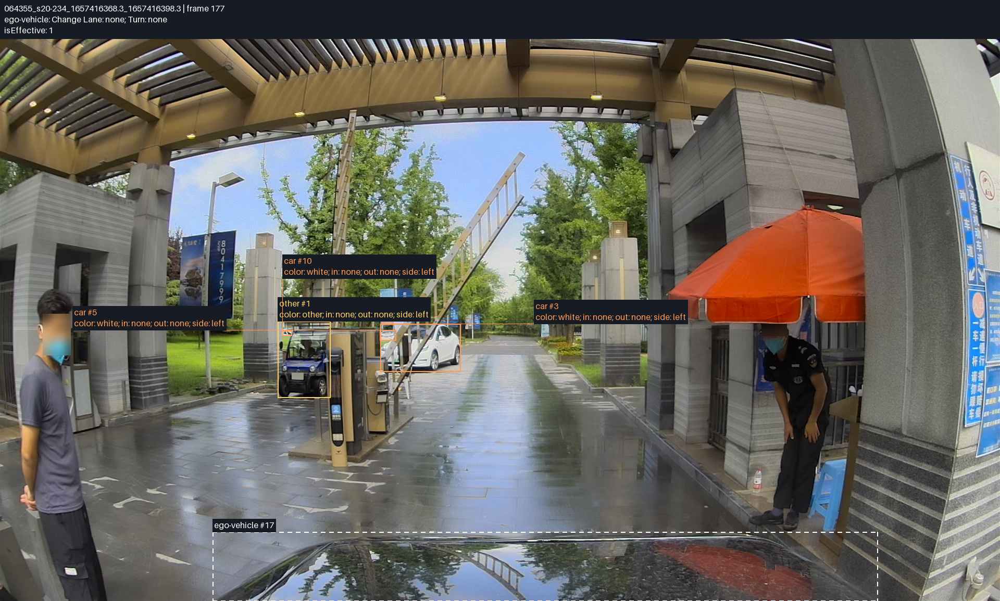

# STRIVE-D-Data

Driving video annotations and visualization tools accompanying:

**[Driving Video Retrieval for Complex Queries with Structured Grounding](https://gyeow.github.io/strive-d/)**<br>
*[Manyi Yao](https://gyeow.github.io/)*,
*[Sparsh Garg](https://www.linkedin.com/in/garg-sparsh/)*,
*[Christian R. Shelton](https://www.cs.ucr.edu/~cshelton/)*,
*[Amit Roy-Chowdhury](https://vcg.ece.ucr.edu/amit)*,
*[Abhishek Aich](https://abhishekaich27.github.io/)*. NeurIPS 2026 (Main Track).

[](https://arxiv.org/abs/2606.09109)
[](https://gyeow.github.io/strive-d/)

## Data

Annotations: [Google Drive](https://drive.google.com/drive/folders/1CHn0Vp5-WCdJi3slAFzDjNETT-GvJQlT).

Video sources:

- [CarCrashDataset](https://github.com/Cogito2012/CarCrashDataset)
- [DrivingDojo](https://github.com/Robertwyq/Drivingdojo)

To visualize the annotations, place the corresponding frame images in the
folders below. Keep their original filenames:

```text
frames/
  <clip_id>/
    <frame>.jpg
annotations/
  car_crash_annotations.json
  clip_annotations/
    <clip_id>/
      <frame>.json
```

For example, `Crash-1500_001488_frame37.jpg` belongs in
`frames/Crash-1500_001488/`.

## Run

Requires Python 3.10+.

```bash
pip install -r requirements.txt
cp paths.example.json paths.json
```

Edit `paths.json` to set your frame and annotation directories. Relative paths
start from the directory containing this file.

```bash
python visualize.py --source coco --clip Crash-1500_001488
python visualize.py --source clip --clip sample-clip
```

Replace `sample-clip` with your clip ID. Use `--list-clips` instead of `--clip`
to list available IDs. The annotated MP4 is saved in `out/`.

## Annotation examples

CarCrashDataset



DrivingDojo



<sub>Sample frames from CarCrashDataset and DrivingDojo, with our annotations overlaid.</sub>

## Citation
If you find our work useful in your research, please cite:
```bibtex
@misc{yao2026strive,
  author = {Manyi Yao and Sparsh Garg and Christian Shelton and Amit Roy-Chowdhury and Abhishek Aich},
  title = {Driving Video Retrieval for Complex Queries with Structured Grounding},
  year = {2026},
  eprint = {2606.09109},
  archivePrefix = {arXiv},
  primaryClass = {cs.CV},
  url = {https://arxiv.org/abs/2606.09109}
}
```

## Acknowledgments

We thank the [CarCrashDataset](https://github.com/Cogito2012/CarCrashDataset) and
[DrivingDojo](https://github.com/Robertwyq/Drivingdojo) authors for making their
benchmarks openly available.
